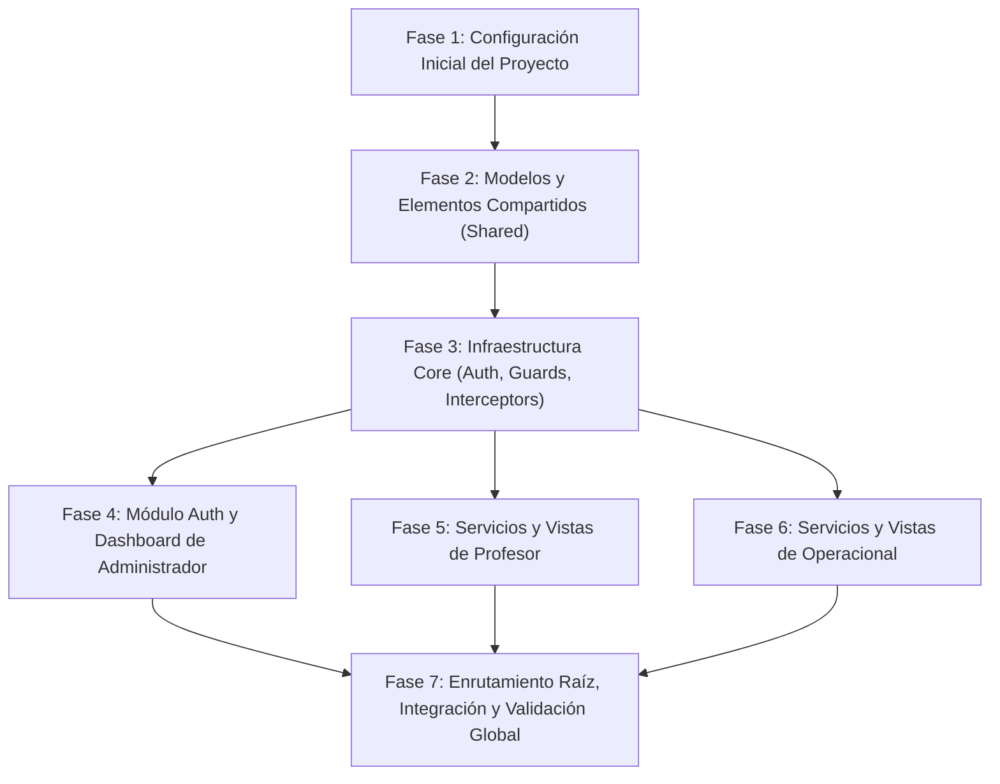

# Lista de Tareas de Implementación: MVP Frontend
## Sistema de Gestión y Reporte de Actividades

El presente documento desglosa la implementación del MVP Frontend en tareas atómicas, ordenadas secuencialmente por dependencia estricta y estimadas en un tiempo máximo de **20 a 30 minutos** cada una. Cada tarea referencia los Requisitos Funcionales (RF) cubiertos y define un criterio de aceptación verificable ("Hecho cuando:").

---

## Resumen de Fases y Dependencias

---

## Fase 1: Configuración Inicial del Proyecto y Entornos

- [x] **TASK-01: Inicialización del proyecto Angular 17+ con Standalone Components**
  - **Duración estimada:** 25 min
  - **Depende de:** Ninguna
  - **RFs cubiertos:** Soporte transversal (RNF-01, RNF-04)
  - **Descripción:** Crear el proyecto base de Angular en modo Standalone (`ng new misw-nube-frontend --standalone --routing --style=scss --skip-tests=false`). Configurar `.editorconfig` y `.gitignore`. Instalar y verificar Bootstrap 5, Bootstrap Icons y `ngx-toastr` en `package.json`. Importar estilos de Bootstrap y Toastr en `src/styles.scss`.
  - **Hecho cuando:** `npm start` compila exitosamente el template inicial y Bootstrap 5 junto con `ngx-toastr` están disponibles en los estilos globales sin errores en la consola.

- [x] **TASK-02: Configuración de entornos y proveedores globales de aplicación**
  - **Duración estimada:** 20 min
  - **Depende de:** TASK-01
  - **RFs cubiertos:** Soporte transversal (RNF-02)
  - **Descripción:** Crear `src/environments/environment.ts` y `src/environments/environment.prod.ts` definiendo la variable `apiUrl: '/api/v1'`. En `src/app/app.config.ts`, configurar `provideHttpClient(withInterceptors([...]))`, `provideRouter(...)` y `provideToastr(...)` con configuración no intrusiva (`timeOut: 4500`, `positionClass: 'toast-top-right'`, `closeButton: true`).
  - **Hecho cuando:** El archivo `app.config.ts` expone los proveedores requeridos de HttpClient, Router y Toastr sin errores de compilación de TypeScript.

---

## Fase 2: Modelos de Dominio y Componentes/Pipes Compartidos (Shared)

- [x] **TASK-03: Definición de modelos TypeScript de Autenticación y Usuario**
  - **Duración estimada:** 20 min
  - **Depende de:** TASK-01
  - **RFs cubiertos:** RF-01, RF-02, RF-03, RF-05
  - **Descripción:** Crear interfaces en `src/app/core/models/auth.model.ts` (`LoginRequest`, `LoginResponse`, `SessionState`) y `src/app/core/models/user.model.ts` (`User`, enum/type `UserRole` con valores `'admin' | 'professor' | 'operational'`). Respetar con exactitud los atributos definidos en `FRONTEND_API_GUIDE.md`.
  - **Hecho cuando:** Ambos archivos de modelos exportan sus tipos e interfaces sin advertencias de TypeScript y coinciden con la especificación del backend.

- [x] **TASK-04: Definición de modelos TypeScript de Dominio Académico y Operativo**
  - **Duración estimada:** 25 min
  - **Depende de:** TASK-01
  - **RFs cubiertos:** RF-06, RF-07, RF-08, RF-09, RF-10, RF-11, RF-12, RF-13
  - **Descripción:** Crear interfaces TypeScript en `src/app/core/models/`:
    - `period.model.ts` (`AcademicPeriod`).
    - `workspace.model.ts` (`Workspace`, `OperationalWorkspace`).
    - `assignment.model.ts` (`AssignmentSummary`, `WeeklyWorkDetail`, `ConsolidatedSummary`, `ConsolidatedWeek`).
    - `task.model.ts` (`Task`, `CreateTaskRequest`, `UpdateTaskRequest`, `WeeklyHistoryItem`).
    - `report.model.ts` (`BatchReportResponse`, `ReportSummary`).
  - **Hecho cuando:** Todos los modelos compilan limpiamente y tipifican al 100% las respuestas y payloads del API guide.

- [x] **TASK-05: Implementación de Pipe de formato para semanas ISO (`IsoWeekPipe`)**
  - **Duración estimada:** 25 min
  - **Depende de:** TASK-01
  - **RFs cubiertos:** RF-07, RF-09, RF-13, RNF-05
  - **Descripción:** Crear `src/app/shared/pipes/iso-week.pipe.ts` con `@Pipe({ name: 'isoWeek', standalone: true })`. Debe transformar cadenas con formato `YYYY-Www` (ej. `2026-W42`) a texto amigable en español (ej. `"Semana 42, 2026"`), manejando valores nulos o inválidos de forma defensiva. Implementar su prueba unitaria `src/app/shared/pipes/iso-week.pipe.spec.ts`.
  - **Hecho cuando:** La suite de pruebas de `iso-week.pipe.spec.ts` se ejecuta con éxito verificando conversión correcta y manejo seguro de valores vacíos o mal formados.

- [x] **TASK-06: Implementación del componente reutilizable `EmptyStateComponent`**
  - **Duración estimada:** 25 min
  - **Depende de:** TASK-01
  - **RFs cubiertos:** RF-06 (EARS-06.4), RF-10 (EARS-10.2), RF-13
  - **Descripción:** Crear el componente Standalone `src/app/shared/components/empty-state/empty-state.component.ts` junto con su template HTML y test `empty-state.component.spec.ts`. Debe recibir `@Input() title: string`, `@Input() message: string`, `@Input() iconClass: string` y renderizar una tarjeta limpia Bootstrap con icono sutil y texto explicativo centrado.
  - **Hecho cuando:** `empty-state.component.spec.ts` valida que el título, mensaje e icono proyectados en el `@Input` se renderizan correctamente en el DOM.

---

## Fase 3: Infraestructura Core (Auth, Guards, Interceptors)

- [x] **TASK-07: Implementación del servicio de autenticación `AuthService`**
  - **Duración estimada:** 30 min
  - **Depende de:** TASK-02, TASK-03
  - **RFs cubiertos:** RF-01, RF-02, RF-03, RF-05
  - **Descripción:** Crear `src/app/core/services/auth.service.ts` con `inject(HttpClient)` y `inject(Router)`. Implementar métodos:
    - `login(credentials: LoginRequest): Observable<LoginResponse>` (persiste token y usuario en `localStorage`, actualiza `currentUser$` con `BehaviorSubject`).
    - `logout(): Observable<void>` (consume `POST /auth/logout`, limpia almacenamiento, emite `null` y redirige a `/login`).
    - `clearSession(): void` (limpieza local síncrona).
    - `getToken()`, `getCurrentUser()`, `isAuthenticated()`, `getRole()`.
    - `redirectByRole(role?: UserRole): void` (mapea `admin` a `/admin/dashboard`, `professor` a `/professor/assignments`, `operational` a `/operational/workspaces`).
    - Crear `src/app/core/services/auth.service.spec.ts` cubriendo login, persistencia, logout y redirecciones.
  - **Hecho cuando:** La suite `auth.service.spec.ts` pasa al 100% usando `HttpTestingController` para simular respuestas exitosas de autenticación y cierre de sesión.

- [x] **TASK-08: Implementación del interceptor de autenticación `AuthInterceptor`**
  - **Duración estimada:** 20 min
  - **Depende de:** TASK-07
  - **RFs cubiertos:** RF-01, RF-04
  - **Descripción:** Crear la función `src/app/core/interceptors/auth.interceptor.ts` de tipo `HttpInterceptorFn`. Inyectar `AuthService`. Si `authService.getToken()` retorna un token activo, clonar la petición HTTP agregando el encabezado `Authorization: Bearer <token>`. Si no hay token, reenviar la petición intacta. Crear `auth.interceptor.spec.ts`.
  - **Hecho cuando:** `auth.interceptor.spec.ts` confirma que las peticiones salientes incluyen la cabecera `Authorization` cuando hay token activo y la omiten cuando es nulo.

- [x] **TASK-09: Implementación del interceptor global de errores `ErrorInterceptor`**
  - **Duración estimada:** 30 min
  - **Depende de:** TASK-02, TASK-07
  - **RFs cubiertos:** RF-01 (EARS-01.2), RF-03 (EARS-03.2), RF-04 (EARS-04.3), RF-09 (EARS-09.6), RNF-02
  - **Descripción:** Crear `src/app/core/interceptors/error.interceptor.ts` de tipo `HttpInterceptorFn`. Inyectar `ToastrService`, `AuthService` y `Router`.
    - Capturar errores HTTP con RxJS `catchError`.
    - 401: invocar `authService.clearSession()`, redirigir a `/login` y emitir `toastr.error('Tu sesión ha expirado o no es válida. Por favor, inicia sesión nuevamente.')`.
    - 403: emitir `toastr.error('No dispones de permisos para realizar esta acción.')`.
    - 404: emitir `toastr.error('El recurso solicitado no fue encontrado.')`.
    - 400 / 422: extraer `error.error.message` y emitir `toastr.error(mensaje)`.
    - 500+ / Fallo de red: emitir notificación de error de servidor o conexión.
    - Re-lanzar error con `throwError(() => error)`.
    - Implementar `error.interceptor.spec.ts`.
  - **Hecho cuando:** `error.interceptor.spec.ts` prueba con éxito las respuestas 401, 403, 404, 500 y fallo de red verificando las llamadas correspondientes a `ToastrService` y la limpieza de sesión en 401.

- [x] **TASK-10: Implementación de Route Guards (`AuthGuard` y `RoleGuard`)**
  - **Duración estimada:** 25 min
  - **Depende de:** TASK-07
  - **RFs cubiertos:** RF-01, RF-02, RF-04 (EARS-04.1, EARS-04.2)
  - **Descripción:** Crear en `src/app/core/guards/`:
    - `auth.guard.ts`: valida `authService.isAuthenticated()`; si es falso redirige a `/login` retornando `false`.
    - `role.guard.ts`: lee roles permitidos desde `route.data['roles']`; si `authService.getRole()` está autorizado retorna `true`, en caso contrario redirige a `/unauthorized` retornando `false`.
    - Implementar `auth.guard.spec.ts` y `role.guard.spec.ts`.
  - **Hecho cuando:** Las pruebas unitarias de ambos guards confirman el bloqueo y redirección de accesos anónimos a `/login` y accesos sin rol a `/unauthorized`.

- [x] **TASK-11: Componente de barra superior de navegación `NavbarComponent`**
  - **Duración estimada:** 30 min
  - **Depende de:** TASK-07
  - **RFs cubiertos:** RF-01, RF-03, RF-05
  - **Descripción:** Crear `src/app/shared/components/navbar/navbar.component.ts`, template y `navbar.component.spec.ts`.
    - Consumir `authService.currentUser$` para mostrar nombre completo y rol amigable en español.
    - Incluir botón *"Cerrar Sesión"* con icono Bootstrap que llama a `authService.logout()`.
    - En caso de éxito o fallo de red, informar con `toastr.info('Has cerrado sesión correctamente.')`.
    - Solo renderizar la barra si hay usuario autenticado.
  - **Hecho cuando:** `navbar.component.spec.ts` verifica la suscripción al usuario activo, la traducción del rol a español y la invocación de `logout()` al hacer click en el botón.

- [x] **TASK-12: Componente de pantalla intermedia `UnauthorizedComponent`**
  - **Duración estimada:** 20 min
  - **Depende de:** TASK-07
  - **RFs cubiertos:** RF-04 (EARS-04.2)
  - **Descripción:** Crear `src/app/features/auth/unauthorized/unauthorized.component.ts`, template y test.
    - Renderizar mensaje amigable en español: *"Acceso No Autorizado: No dispones de los permisos requeridos para ingresar a esta sección."* con clase Bootstrap `alert alert-warning` o card centrada.
    - Botón primario *"Regresar a mi Panel Principal"* que ejecuta `authService.redirectByRole()`.
  - **Hecho cuando:** `unauthorized.component.spec.ts` valida que el mensaje de advertencia se muestra y que el click en el botón redirige al usuario según su rol activo.

---

## Fase 4: Módulo Auth y Dashboard de Administrador

- [x] **TASK-13: Pantalla de inicio de sesión `LoginComponent`**
  - **Duración estimada:** 30 min
  - **Depende de:** TASK-07, TASK-09
  - **RFs cubiertos:** RF-01 (EARS-01.1, EARS-01.2, EARS-01.3), RF-02
  - **Descripción:** Crear `src/app/features/auth/login/login.component.ts`, template y `login.component.spec.ts`.
    - Formulario reactivo `loginForm` con `email` (requerido, email) y `password` (requerido).
    - Al enviar inválido: ejecutar `markAllAsTouched()` y aplicar clases `is-invalid` nativas sin enviar petición HTTP (EARS-01.3).
    - Al enviar válido: llamar a `authService.login(credentials)`. Al resolver `next`, llamar a `authService.redirectByRole()`.
    - **Cero variables de carga (`loading`)**. Los errores 401 son manejados automáticamente por el `ErrorInterceptor` manteniendo al usuario en la vista.
  - **Hecho cuando:** `login.component.spec.ts` valida el bloqueo de envío con formulario inválido, la llamada a `authService.login()` con credenciales correctas y la posterior llamada a `redirectByRole()`.

- [x] **TASK-14: Panel de bienvenida del Administrador `AdminDashboardComponent`**
  - **Duración estimada:** 25 min
  - **Depende de:** TASK-07
  - **RFs cubiertos:** RF-02, RF-05 (EARS-05.1, EARS-05.2)
  - **Descripción:** Crear `src/app/features/admin/dashboard/admin-dashboard.component.ts`, template y `admin-dashboard.component.spec.ts`.
    - Obtener `currentUser` desde `authService.getCurrentUser()`.
    - Renderizar tarjeta Bootstrap con nombre del administrador, correo institucional, rol activo (`admin`) y estado de sesión (`Activa`).
    - Verificar la ausencia total de controles operativos, tablas de gestión académica o botones de edición.
  - **Hecho cuando:** `admin-dashboard.component.spec.ts` verifica que los datos de sesión se visualizan en el template y que no existen botones o enlaces de gestión en el DOM.

---

## Fase 5: Servicios y Vistas del Rol Profesor (Supervisión y Reportes)

- [x] **TASK-15: Implementación del servicio `AssignmentService` para el docente**
  - **Duración estimada:** 25 min
  - **Depende de:** TASK-02, TASK-04
  - **RFs cubiertos:** RF-06, RF-07, RF-08
  - **Descripción:** Crear `src/app/core/services/assignment.service.ts` y su archivo de pruebas unitarias `assignment.service.spec.ts`.
    - Implementar `getAssignments(): Observable<AssignmentsResponse>` (`GET /assignments`).
    - Implementar `getWeeklyDetail(assignmentId: number, week?: string): Observable<WeeklyWorkDetail>` (`GET /assignments/:id/weekly`, agregando `?week=` si está definido).
    - Implementar `getConsolidatedDetail(assignmentId: number): Observable<ConsolidatedSummary>` (`GET /assignments/:id/consolidated`).
  - **Hecho cuando:** `assignment.service.spec.ts` verifica con `HttpTestingController` las peticiones GET con sus respectivas URLs, query params y mapeos de datos.

- [x] **TASK-16: Vista principal del docente: lista de vinculaciones `ProfessorAssignmentsComponent`**
  - **Duración estimada:** 30 min
  - **Depende de:** TASK-06, TASK-15
  - **RFs cubiertos:** RF-02, RF-06 (EARS-06.1, EARS-06.2, EARS-06.3, EARS-06.4)
  - **Descripción:** Crear `src/app/features/professor/assignments/professor-assignments.component.ts`, template y `professor-assignments.component.spec.ts`.
    - En `ngOnInit`, llamar a `assignmentService.getAssignments()`. Sin estados de carga.
    - Renderizar tabla con columnas: Persona, Curso/Proyecto, Rol, Horas Contratadas vs Reportadas, Estado del Reporte (Badge verde `bg-success` *"Reportado"* o Badge rojo `bg-danger` *"Sin reporte"*).
    - Botones de acción por fila: *"Ver Detalle Semanal"* (`/professor/assignments/:id/weekly`) y *"Ver Histórico"* (`/professor/assignments/:id/consolidated`).
    - Si la lista está vacía, renderizar `<app-empty-state>` (EARS-06.4).
  - **Hecho cuando:** `professor-assignments.component.spec.ts` valida el renderizado de la tabla con badges semánticos correctos y la presentación del empty state cuando la respuesta no contiene elementos.

- [x] **TASK-17: Vista de detalle semanal de trabajo `ProfessorWeeklyDetailComponent`**
  - **Duración estimada:** 30 min
  - **Depende de:** TASK-05, TASK-15
  - **RFs cubiertos:** RF-07 (EARS-07.1, EARS-07.2, EARS-07.3, EARS-07.4)
  - **Descripción:** Crear `src/app/features/professor/weekly-detail/professor-weekly-detail.component.ts`, template y test.
    - Leer `:id` de la ruta activa (`ActivatedRoute`).
    - Selector dropdown de semanas que al cambiar dispara `getWeeklyDetail(id, selectedWeek)`.
    - Tarjeta de balance de horas: si `reported_hours > contracted_hours`, mostrar badge `badge bg-warning text-dark` indicando sobrecumplimiento de horas (EARS-07.3).
    - Tabla de tareas: Título, Descripción, Horas invertidas, Estado (Badge `FINALIZADA` verde o `PENDIENTE` amarillo), Observaciones y Badge *"Tardío"* si `is_late_report` es verdadero.
    - Botón para volver al listado de vinculaciones.
  - **Hecho cuando:** `professor-weekly-detail.component.spec.ts` comprueba la carga de tareas semanales, la actualización al cambiar el selector de semana y la visualización del badge de sobrecumplimiento.

- [x] **TASK-18: Vista de consolidado acumulado `ProfessorConsolidatedDetailComponent`**
  - **Duración estimada:** 30 min
  - **Depende de:** TASK-05, TASK-15
  - **RFs cubiertos:** RF-08 (EARS-08.1, EARS-08.2)
  - **Descripción:** Crear `src/app/features/professor/consolidated-detail/professor-consolidated-detail.component.ts`, template y test.
    - Leer `:id` de la ruta activa y llamar a `assignmentService.getConsolidatedDetail(id)`.
    - Tarjetas métricas: Total horas reportadas vs contratadas, porcentaje de cumplimiento global y cantidad de semanas sin reporte.
    - Tabla cronológica de semanas: filas de semanas transcurridas sin reporte destacadas con badge rojo `badge bg-danger` *"Sin reporte"*.
    - Botón de regreso al listado de vinculaciones.
  - **Hecho cuando:** `professor-consolidated-detail.component.spec.ts` verifica el cálculo y renderizado de métricas acumuladas y la marcación de semanas sin reporte en la tabla histórica.

- [x] **TASK-19: Implementación del servicio de reportes `ReportService`**
  - **Duración estimada:** 25 min
  - **Depende de:** TASK-02, TASK-04
  - **RFs cubiertos:** RF-09, RNF-06
  - **Descripción:** Crear `src/app/core/services/report.service.ts` y su prueba `report.service.spec.ts`.
    - `triggerBatchReport(week: string): Observable<BatchReportResponse>` (`POST /reports/batch`).
    - `getReports(week: string): Observable<ReportSummary[]>` (`GET /reports?week=`).
    - `downloadReportPdf(reportId: number, filename?: string): Observable<Blob>` (`GET /reports/:id/download` con `{ responseType: 'blob' }`).
    - `downloadBatchZip(batchId: number, filename?: string): Observable<Blob>` (`GET /reports/batch/:id/download` con `{ responseType: 'blob' }`).
    - Helper privado o utilitario para invocar `URL.createObjectURL(blob)` y forzar descarga en el navegador sin recargar la página.
  - **Hecho cuando:** `report.service.spec.ts` confirma las llamadas HTTP a los endpoints de reportes y la recepción de objetos `Blob` en las descargas.

- [x] **TASK-20: Vista de generación y descarga de reportes PDF/ZIP `ProfessorReportsComponent`**
  - **Duración estimada:** 30 min
  - **Depende de:** TASK-05, TASK-19
  - **RFs cubiertos:** RF-09 (EARS-09.1, EARS-09.2, EARS-09.3, EARS-09.4, EARS-09.5, EARS-09.6), RNF-06
  - **Descripción:** Crear `src/app/features/professor/reports/professor-reports.component.ts`, template y test.
    - Selector de semanas concluidas (semanas cerradas).
    - Deshabilitar el botón *"Generar Reportes por Lote"* si se selecciona la semana en curso o futura (EARS-09.2).
    - Disparo de lote: invocar `reportService.triggerBatchReport(selectedWeek)` y emitir `toastr.success('La generación del lote de reportes ha sido iniciada exitosamente.')` tras respuesta `202 Accepted`.
    - Listado de reportes generados con botones para descargar PDF individual por estudiante y botón global *"Descargar Lote (ZIP)"*.
    - Cero pantallas de carga. Fallos de descarga son interceptados vía Toastr.
  - **Hecho cuando:** `professor-reports.component.spec.ts` verifica el estado `disabled` del botón para semanas activas/futuras, la invocación de `triggerBatchReport` para semanas cerradas y la ejecución de descarga de archivos.

---

## Fase 6: Servicios y Vistas del Rol Operacional (Cursos, Tareas e Historial)

- [x] **TASK-21: Implementación del servicio de espacios de trabajo `WorkspaceService`**
  - **Duración estimada:** 20 min
  - **Depende de:** TASK-02, TASK-04
  - **RFs cubiertos:** RF-10
  - **Descripción:** Crear `src/app/core/services/workspace.service.ts` y su archivo de pruebas unitarias `workspace.service.spec.ts`.
    - Implementar `getMyWorkspaces(): Observable<OperationalWorkspace[]>` consumiendo `GET /workspaces`.
  - **Hecho cuando:** `workspace.service.spec.ts` valida la emisión de la petición `GET /workspaces` y la correcta recepción del listado tipado de espacios asignados.

- [x] **TASK-22: Vista de cursos y proyectos asignados `OperationalWorkspacesComponent`**
  - **Duración estimada:** 25 min
  - **Depende de:** TASK-06, TASK-21
  - **RFs cubiertos:** RF-02, RF-10 (EARS-10.1, EARS-10.2)
  - **Descripción:** Crear `src/app/features/operational/workspaces/operational-workspaces.component.ts`, template y `operational-workspaces.component.spec.ts`.
    - En `ngOnInit`, llamar a `workspaceService.getMyWorkspaces()`.
    - Renderizar tarjetas o tabla con: Nombre de curso/proyecto, Docente responsable, Rol (`Monitor` o `Asistente Graduado`), Horas semanales y Estado (`ACTIVO` verde o `CERRADO` gris).
    - Botones de acción por espacio: *"Gestionar Tareas"* (`/operational/workspaces/:assignmentId/tasks`) e *"Historial"* (`/operational/workspaces/:assignmentId/history`).
    - Si no tiene cursos vinculados, renderizar `<app-empty-state>` con *"No tienes cursos ni proyectos asignados en el período actual."*.
  - **Hecho cuando:** `operational-workspaces.component.spec.ts` verifica el renderizado de los cursos con sus badges y la presentación de empty state si el arreglo de vinculaciones está vacío.

- [x] **TASK-23: Implementación del servicio de tareas `TaskService`**
  - **Duración estimada:** 25 min
  - **Depende de:** TASK-02, TASK-04
  - **RFs cubiertos:** RF-07, RF-11, RF-12, RF-13
  - **Descripción:** Crear `src/app/core/services/task.service.ts` y `task.service.spec.ts`.
    - Implementar `createTask(payload: CreateTaskRequest): Observable<Task>` (`POST /tasks`).
    - Implementar `getTasks(assignmentId: number, week?: string): Observable<Task[]>` (`GET /tasks`).
    - Implementar `updateTask(taskId: number, payload: UpdateTaskRequest): Observable<Task>` (`PUT /tasks/:id`).
    - Implementar `deleteTask(taskId: number): Observable<void>` (`DELETE /tasks/:id`).
    - Implementar `getTaskHistory(assignmentId: number): Observable<WeeklyHistoryItem[]>` (`GET /tasks/history?assignment_id=`).
  - **Hecho cuando:** `task.service.spec.ts` comprueba mediante `HttpTestingController` las operaciones CRUD completas y la consulta del historial de tareas.

- [x] **TASK-24: Formulario y registro de tareas semanales en `OperationalTasksComponent`**
  - **Duración estimada:** 30 min
  - **Depende de:** TASK-05, TASK-23
  - **RFs cubiertos:** RF-11 (EARS-11.1, EARS-11.2, EARS-11.3, EARS-11.4, EARS-11.5, EARS-11.6, EARS-11.7)
  - **Descripción:** Crear `src/app/features/operational/tasks/operational-tasks.component.ts` (primera parte: creación y formulario), template HTML y base de pruebas.
    - Formulario reactivo `taskForm`: campos `week`, `title`, `description`, `status` (`FINALIZADA` / `PENDIENTE`), `hours_spent` y `observations`. Sin campo de adjuntos (EARS-11.2).
    - Validador síncrono para `hours_spent` exigiendo enteros estrictamente positivos: `Validators.pattern('^[1-9][0-9]*$')` (EARS-11.7).
    - Selector de semana: restringir a semana actual o pasadas (bloquear semanas futuras, EARS-11.3).
    - Advertencia reactiva: si la semana seleccionada es una semana pasada ya concluida, desplegar banner de advertencia indicando que se guardará como *"Reporte Tardío"* y será inmutable (EARS-11.4).
    - Al enviar con éxito: llamar a `taskService.createTask(...)`, emitir `toastr.success('Tarea registrada exitosamente.')`, limpiar formulario y refrescar lista de tareas.
  - **Hecho cuando:** Las pruebas unitarias confirman la invalidación de horas no enteras o <= 0, el encendido de la advertencia de reporte tardío para semanas pasadas y la creación de tareas.

- [x] **TASK-25: Edición y eliminación condicionada de tareas en `OperationalTasksComponent`**
  - **Duración estimada:** 30 min
  - **Depende de:** TASK-24
  - **RFs cubiertos:** RF-12 (EARS-12.1, EARS-12.2, EARS-12.3, EARS-12.4)
  - **Descripción:** Completar `operational-tasks.component.ts` y su archivo de pruebas unitarias `operational-tasks.component.spec.ts`.
    - Renderizar lista/tabla de tareas de la semana activa.
    - Condición de mutabilidad: controles de editar y eliminar habilitados **únicamente** si `week === currentWeek`, el espacio está abierto y la tarea tiene `is_late_report === false` (EARS-12.1).
    - Si la tarea es reporte tardío, semana concluida o espacio cerrado, ocultar/deshabilitar controles mostrando modo solo lectura (EARS-12.2).
    - Modal de confirmación nativo de Bootstrap antes de borrar (EARS-12.3).
    - Al actualizar o borrar con éxito, emitir `toastr.success(...)` y refrescar el listado y balance de horas (EARS-12.4).
  - **Hecho cuando:** `operational-tasks.component.spec.ts` verifica que una tarea tardía o de espacio cerrado no muestra botones de edición/borrado, y que la eliminación de una tarea válida dispara la petición DELETE y actualiza la vista.

- [x] **TASK-26: Vista de historial cronológico de trabajo `OperationalHistoryComponent`**
  - **Duración estimada:** 25 min
  - **Depende de:** TASK-05, TASK-23
  - **RFs cubiertos:** RF-13 (EARS-13.1, EARS-13.2)
  - **Descripción:** Crear `src/app/features/operational/history/operational-history.component.ts`, template y test.
    - Obtener `assignmentId` de los parámetros de ruta y llamar a `taskService.getTaskHistory(assignmentId)`.
    - Tabla semana a semana: Semana formateada con `IsoWeekPipe`, Horas acumuladas, Conteo de tareas, Badge de estado (`Reportado` o `Sin reporte`) y Badge *"Contiene reportes tardíos"* si aplica (EARS-13.1).
    - Acordeón o fila expandible: al hacer click en una fila, desplegar las tareas registradas en esa semana específica (EARS-13.2).
  - **Hecho cuando:** `operational-history.component.spec.ts` verifica el renderizado de las semanas históricas y la expansión de tareas detalladas al seleccionar una fila.

---

## Fase 7: Enrutamiento Raíz, Integración y Validación Global

- [x] **TASK-27: Configuración de enrutamiento declarativo y contenedor raíz en `app.routes.ts`**
  - **Duración estimada:** 25 min
  - **Depende de:** TASK-10, TASK-11, TASK-12, TASK-13, TASK-14, TASK-16, TASK-17, TASK-18, TASK-20, TASK-22, TASK-25, TASK-26
  - **RFs cubiertos:** RF-01, RF-02, RF-03, RF-04
  - **Descripción:** Definir la matriz completa de rutas en `src/app/app.routes.ts`:
    - `/login` -> `LoginComponent`.
    - `/unauthorized` -> `UnauthorizedComponent` (con `AuthGuard`).
    - `/admin/dashboard` -> `AdminDashboardComponent` (`canActivate: [AuthGuard, RoleGuard]`, `data: { roles: ['admin'] }`).
    - `/professor/assignments` -> `ProfessorAssignmentsComponent` (`roles: ['professor']`).
    - `/professor/assignments/:id/weekly` -> `ProfessorWeeklyDetailComponent` (`roles: ['professor']`).
    - `/professor/assignments/:id/consolidated` -> `ProfessorConsolidatedDetailComponent` (`roles: ['professor']`).
    - `/professor/reports` -> `ProfessorReportsComponent` (`roles: ['professor']`).
    - `/operational/workspaces` -> `OperationalWorkspacesComponent` (`roles: ['operational']`).
    - `/operational/workspaces/:assignmentId/tasks` -> `OperationalTasksComponent` (`roles: ['operational']`).
    - `/operational/workspaces/:assignmentId/history` -> `OperationalHistoryComponent` (`roles: ['operational']`).
    - `''` (raíz) -> Redirección condicional según rol con guard / helper.
    - `**` (comodín) -> Redirección a `/login` si es anónimo o al home del rol si está autenticado.
    - Configurar `app.component.html` con `<app-navbar>` y `<router-outlet>`.
  - **Hecho cuando:** Se puede navegar a las rutas declaradas respetando las restricciones de guard, y la ruta raíz redirige automáticamente al panel del rol activo.

- [x] **TASK-28: Validación integral de calidad: compilación de producción y suite de pruebas unitarias**
  - **Duración estimada:** 30 min
  - **Depende de:** TASK-01 a TASK-27
  - **RFs cubiertos:** Todos los RFs (RF-01 a RF-13) y RNFs (RNF-01 a RNF-06)
  - **Descripción:** Ejecutar `ng test --watch=false --browsers=ChromeHeadless` asegurando que todos los specs unitarios pasen sin fallas. Ejecutar `ng build --configuration=production` para verificar que la compilación de producción finalice sin errores de tipos, sintaxis o advertencias de empaquetado. Comprobar que no exista ninguna bandera o spinner de carga en el código fuente.
  - **Hecho cuando:** `ng test` ejecuta el 100% de las pruebas unitarias con resultado verde y `ng build` genera los artefactos de distribución en `dist/` con código de salida 0.

---

## Matriz de Cobertura de Requisitos Funcionales vs Tareas

| Requisito Funcional | Denominación del Requerimiento | Tareas que lo cubren |
|:---:|---|:---:|
| **RF-01** | Autenticación Local de Usuarios | TASK-03, TASK-07, TASK-08, TASK-09, TASK-10, TASK-11, TASK-13, TASK-27, TASK-28 |
| **RF-02** | Enrutamiento Inicial Diferenciado por Rol | TASK-03, TASK-07, TASK-10, TASK-13, TASK-14, TASK-16, TASK-22, TASK-27, TASK-28 |
| **RF-03** | Cierre de Sesión Seguro | TASK-03, TASK-07, TASK-09, TASK-11, TASK-27, TASK-28 |
| **RF-04** | Protección de Rutas y Control de Expiración | TASK-08, TASK-09, TASK-10, TASK-12, TASK-27, TASK-28 |
| **RF-05** | Panel de Inicio del Administrador | TASK-03, TASK-07, TASK-11, TASK-14, TASK-28 |
| **RF-06** | Consulta de Personas Vinculadas a Cargo | TASK-04, TASK-06, TASK-15, TASK-16, TASK-28 |
| **RF-07** | Detalle Semanal de Trabajo de Persona Vinculada | TASK-04, TASK-05, TASK-15, TASK-17, TASK-23, TASK-28 |
| **RF-08** | Consolidado Histórico Acumulado de Vinculación | TASK-04, TASK-15, TASK-18, TASK-28 |
| **RF-09** | Generación y Descarga de Reportes en PDF | TASK-04, TASK-05, TASK-09, TASK-19, TASK-20, TASK-28 |
| **RF-10** | Consulta de Espacios de Trabajo Asignados | TASK-04, TASK-06, TASK-21, TASK-22, TASK-28 |
| **RF-11** | Registro de Tareas Semanales | TASK-04, TASK-05, TASK-23, TASK-24, TASK-28 |
| **RF-12** | Edición y Eliminación de Tareas | TASK-04, TASK-23, TASK-25, TASK-28 |
| **RF-13** | Historial de Registros Semanales | TASK-04, TASK-05, TASK-23, TASK-26, TASK-28 |
